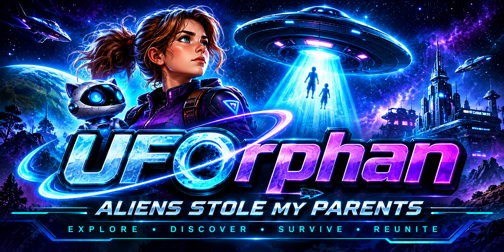
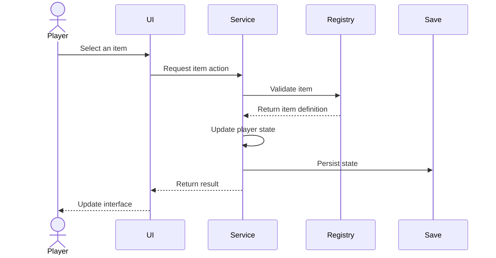
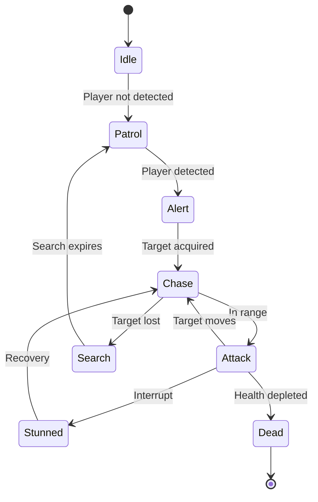
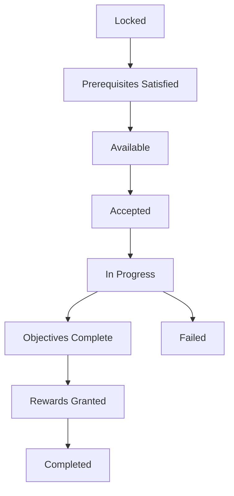
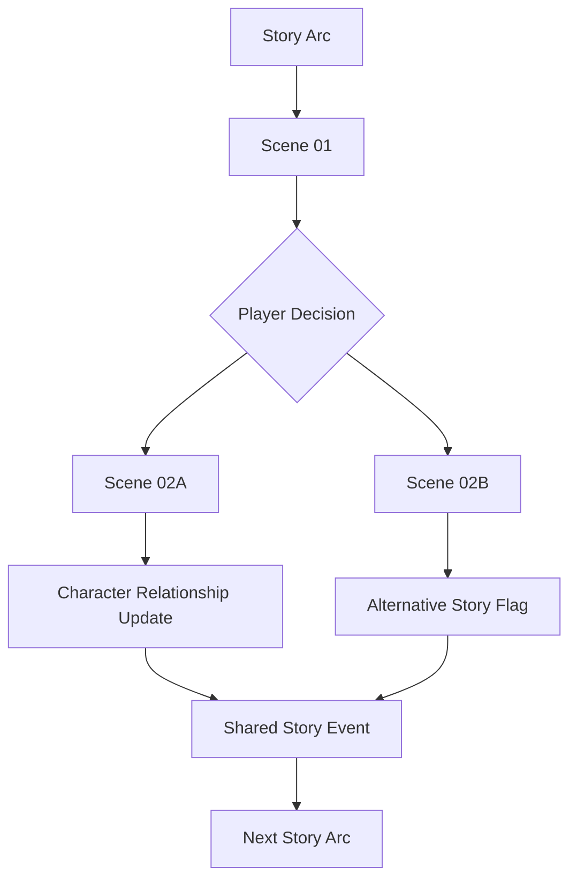
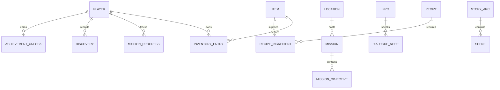

# UFOrphan: Aliens Stole My Parents
### A Complete Science-Fiction Adventure Game, Interactive World Simulation & Narrative Development Platform

<p align="center">

**EXPLORE THE UNKNOWN. UNCOVER THE TRUTH. FIND YOUR FAMILY.**

A richly interconnected science-fiction adventure featuring exploration, combat, crafting, procedural encounters, companion relationships, alien civilizations, branching narratives, and an integrated in-game software suite.



</p>

<p align="center">


</p>

---

# Table of Contents

1. [Project Overview](#1-project-overview)
2. [Vision and Design Philosophy](#2-vision-and-design-philosophy)
3. [Core Features](#3-core-features)
4. [Game World and Narrative](#4-game-world-and-narrative)
5. [Software Architecture](#5-software-architecture)
6. [Repository Structure](#6-repository-structure)
7. [Technology Stack](#7-technology-stack)
8. [Gameplay Engine](#8-gameplay-engine)
9. [World Simulation System](#9-world-simulation-system)
10. [Player Progression](#10-player-progression)
11. [Inventory and Equipment](#11-inventory-and-equipment)
12. [Combat and Enemy AI](#12-combat-and-enemy-ai)
13. [Missions and Quest Management](#13-missions-and-quest-management)
14. [NPCs, Companions and Relationships](#14-npcs-companions-and-relationships)
15. [Crafting and Economy](#15-crafting-and-economy)
16. [Galaxy Navigation and Exploration](#16-galaxy-navigation-and-exploration)
17. [Fiona's Field Terminal](#17-fionas-field-terminal)
18. [Story Studio](#18-story-studio)
19. [Mock Data and World Population](#19-mock-data-and-world-population)
20. [Persistence and Save Architecture](#20-persistence-and-save-architecture)
21. [User Interface and Accessibility](#21-user-interface-and-accessibility)
22. [Application Data Models](#22-application-data-models)
23. [Internal APIs and Event Architecture](#23-internal-apis-and-event-architecture)
24. [Installation and Local Development](#24-installation-and-local-development)
25. [Testing and Quality Assurance](#25-testing-and-quality-assurance)
26. [Performance and Optimization](#26-performance-and-optimization)
27. [Security and Reliability](#27-security-and-reliability)
28. [Deployment](#28-deployment)
29. [Developer Extension Guide](#29-developer-extension-guide)
30. [Roadmap](#30-roadmap)
31. [Contributing](#31-contributing)
32. [Troubleshooting](#32-troubleshooting)
33. [License and Credits](#33-license-and-credits)

---

# 1. Project Overview

## 1.1 What is UFOrphan?

**UFOrphan: Aliens Stole My Parents** is a science-fiction adventure game and interconnected world-management application.

The player controls Fiona Gallegar, a young protagonist whose parents have mysteriously disappeared following an extraterrestrial abduction.

What begins as a personal search becomes an expansive journey through alien civilizations, abandoned research facilities, hostile planets, mysterious artifacts, forgotten technologies, and an increasingly complicated interstellar conspiracy.

UFOrphan combines traditional game mechanics with a sophisticated collection of management and narrative tools.

The application is designed around several interconnected experiences:

- A playable exploration and combat game.
- A multi-region science-fiction universe.
- A mission and narrative progression engine.
- A player inventory and equipment system.
- A crafting and economic simulation.
- An alien encyclopedia and discovery database.
- A companion and relationship system.
- An interactive galaxy navigation interface.
- Fiona's Field Terminal.
- An integrated Story Studio.
- A persistent player progression system.

The central design principle is that every subsystem contributes to a unified game world.

Discovering an artifact can unlock a codex entry. A codex entry can reveal a mission clue. Completing that mission can unlock a new planet. Visiting that planet can introduce an NPC, unlock a crafting recipe, and reveal another piece of Fiona's family history.

The result is a game in which exploration, narrative, progression, and application functionality reinforce one another.

## 1.2 Project Goals

UFOrphan was developed to demonstrate how a browser-based game can incorporate the complexity of a larger software platform.

Its primary objectives are:

1. Create a complete playable science-fiction adventure.
2. Build a modular architecture that supports independent game systems.
3. Create a large interconnected fictional universe.
4. Provide meaningful player progression.
5. Support extensive fictional data populations.
6. Integrate management interfaces directly into gameplay.
7. Provide reusable narrative-development tools.
8. Support persistent local gameplay sessions.
9. Make the application extensible without rewriting its foundations.
10. Provide a complete developer-facing technical structure.

## 1.3 Application Categories

| Category | Description |
|---|---|
| Adventure game | Exploration, movement, combat and objectives |
| RPG systems | Equipment, levels, inventory and progression |
| Simulation | World events, resources and alien populations |
| Narrative engine | Missions, dialogue and branching stories |
| Management software | Field Terminal and player analytics |
| Creative software | Story Studio and scene management |
| Knowledge system | Codex, discoveries and world lore |
| Data application | Structured mock data and persistence |

## 1.4 Intended Audience

UFOrphan is intended for:

- Players interested in science-fiction adventure games.
- Developers studying modular browser-game architecture.
- Game designers developing narrative-driven worlds.
- Technical artists building interactive environments.
- Writers creating branching fictional narratives.
- Developers experimenting with local-first application design.

---

# 2. Vision and Design Philosophy

## 2.1 A World That Feels Connected

The game is not designed as a collection of unrelated screens.

Each interface should reflect the same underlying universe.

For example:

1. Fiona discovers an encrypted artifact.
2. The inventory records the object.
3. The codex recognizes the artifact's origin.
4. A new mission becomes available.
5. The galaxy map reveals a corresponding location.
6. A companion comments on the discovery.
7. The Field Terminal records the event.
8. Story Studio can reference the discovery as a narrative event.

This approach establishes a shared data foundation.

## 2.2 Modular Architecture

Every major feature is separated into a logical system.

The combat system should not need to know how the shop renders its interface. The shop should not need to understand how the canvas draws an enemy.

Instead, systems communicate through defined interfaces and events.

This makes it possible to:

- Replace an individual subsystem.
- Add new chapters.
- Extend existing content.
- Test features independently.
- Reuse services.
- Introduce new interfaces without rewriting gameplay.

## 2.3 Local-First Design

The application prioritizes a usable browser experience.

Core gameplay state is maintained locally, with persistence handled through browser storage.

The architecture can be extended with server-side synchronization if a future release introduces accounts, cloud saves, or multiplayer functionality.

## 2.4 Narrative-Driven Mechanics

Gameplay mechanics reinforce the central narrative.

Fiona's personal motivation is the reason to explore. Discoveries provide clues. Companions offer different perspectives. Boss encounters reveal pieces of the larger mystery.

Progression is therefore both mechanical and narrative.

---

# 3. Core Features

## 3.1 Main Game

The core game provides:

- Player movement.
- Jumping and platform navigation.
- Collision detection.
- Combat interactions.
- Enemy encounters.
- Collectible objects.
- Environmental hazards.
- Checkpoints.
- Chapter transitions.
- Boss encounters.
- Progression tracking.

## 3.2 Eight Main Chapters

The completed expanded game includes eight primary chapters.

| Chapter | Region | Primary Theme |
|---|---|---|
| 1 | Backyard | The initial abduction |
| 2 | Moon Mall | Alien commercial society |
| 3 | Scrap Belt | Salvage and survival |
| 4 | Mothership | The first major conspiracy |
| 5 | Crystal Grove | Ancient alien ecosystems |
| 6 | Orbital Archive | Lost scientific records |
| 7 | Bio-Dome | Experimental alien life |
| 8 | Eclipse Core | Endgame revelations |

Each chapter contains locations, enemies, objectives, collectibles, and narrative progression.

## 3.3 Supporting Systems

The complete application also includes:

- Inventory management.
- Equipment comparisons.
- Crafting.
- Shops.
- Missions.
- NPC interactions.
- Companion management.
- Achievements.
- Galaxy navigation.
- Codex discoveries.
- Player statistics.
- Save profiles.
- Story Studio.

---

# 4. Game World and Narrative

## 4.1 Main Character

### Fiona Gallegar

Fiona is the central playable character.

Her journey begins with the disappearance of her parents, who have been taken by an unknown extraterrestrial force.

The player gradually discovers that the abduction is connected to a much larger scientific and political mystery.

Fiona's character development is reflected through:

- Experience progression.
- Equipment upgrades.
- New abilities.
- Companion relationships.
- Dialogue decisions.
- Story discoveries.
- Mission outcomes.

## 4.2 Narrative Structure

The story uses a chapter-based progression system.

Each chapter has:

- An introduction.
- Environmental storytelling.
- Primary objectives.
- Optional objectives.
- Discoverable lore.
- Enemy encounters.
- NPC interactions.
- A chapter conclusion.

Story progression is controlled by mission requirements and world-state flags.

## 4.3 Branching Decisions

Major narrative decisions can influence:

- NPC relationships.
- Available dialogue.
- Companion reactions.
- Mission availability.
- Reputation.
- Optional encounters.
- Ending variations.

The design supports multiple consequences without requiring every scene to be duplicated.

## 4.4 Environmental Storytelling

The world communicates information through:

- Abandoned laboratories.
- Damaged machinery.
- Alien inscriptions.
- Audio logs.
- Research documents.
- Hidden rooms.
- Unusual environmental effects.
- Collectible artifacts.

These discoveries populate the codex and can contribute to quest progression.

---

# 5. Software Architecture

## 5.1 Architectural Overview

UFOrphan uses a modular client-side application architecture.

The major layers are:

1. Presentation layer.
2. Gameplay layer.
3. Application service layer.
4. World-data layer.
5. Persistence layer.

Each layer has a distinct responsibility.

```mermaid
flowchart TD
    A[UFOrphan Application] --> B[Presentation Layer]
    A --> C[Gameplay Layer]
    A --> D[Application Services]
    A --> E[World Data]
    A --> F[Persistence]

    B --> B1[Main Menu]
    B --> B2[Game HUD]
    B --> B3[Field Terminal]
    B --> B4[Story Studio]

    C --> C1[Player Controller]
    C --> C2[Physics]
    C --> C3[Combat]
    C --> C4[Enemy AI]
    C --> C5[Chapter Manager]

    D --> D1[Mission Service]
    D --> D2[Inventory Service]
    D --> D3[Crafting Service]
    D --> D4[Dialogue Service]
    D --> D5[Achievement Service]

    E --> E1[World Registry]
    E --> E2[Character Registry]
    E --> E3[Item Registry]
    E --> E4[Quest Registry]

    F --> F1[Save Manager]
    F --> F2[Local Storage]
    F --> F3[Migration System]
```



## 5.2 Separation of Concerns

The presentation layer is responsible for displaying information and collecting player input.

The gameplay layer handles simulation and interaction.

Application services coordinate changes across systems.

The data layer provides definitions for game objects.

The persistence layer saves and restores player state.

## 5.3 Service-Oriented Design

Examples of application services include:

| Service | Responsibility |
|---|---|
| PlayerService | Player state and progression |
| InventoryService | Item ownership and quantities |
| MissionService | Objectives and completion |
| DialogueService | Conversations and branching |
| CraftingService | Recipes and material consumption |
| ShopService | Purchases and transactions |
| MapService | Location discovery |
| CodexService | Knowledge and lore |
| AchievementService | Unlock requirements |
| SaveService | Persistence and restoration |

## 5.4 Data Flow

A typical player interaction follows this sequence:



This prevents interface components from directly modifying unrelated systems.

---

# 6. Repository Structure

The repository is organized to separate gameplay, application interfaces, data, documentation, and tests.

A representative structure is:

```text
UFOrphan/
│
├── index.html
├── README.md
├── LICENSE
├── CHANGELOG.md
├── package.json
│
├── assets/
│   ├── images/
│   ├── sprites/
│   ├── backgrounds/
│   ├── icons/
│   ├── audio/
│   └── fonts/
│
├── src/
│   ├── main.js
│   ├── bootstrap.js
│   │
│   ├── core/
│   │   ├── event-bus.js
│   │   ├── game-loop.js
│   │   ├── state-manager.js
│   │   ├── registry.js
│   │   └── configuration.js
│   │
│   ├── engine/
│   │   ├── renderer.js
│   │   ├── physics.js
│   │   ├── collision.js
│   │   ├── camera.js
│   │   └── input.js
│   │
│   ├── gameplay/
│   │   ├── player/
│   │   ├── combat/
│   │   ├── enemies/
│   │   ├── chapters/
│   │   ├── collectibles/
│   │   └── progression/
│   │
│   ├── services/
│   │   ├── inventory-service.js
│   │   ├── mission-service.js
│   │   ├── crafting-service.js
│   │   ├── dialogue-service.js
│   │   ├── achievement-service.js
│   │   └── save-service.js
│   │
│   ├── world/
│   │   ├── regions/
│   │   ├── locations/
│   │   ├── characters/
│   │   ├── species/
│   │   └── events/
│   │
│   ├── data/
│   │   ├── items/
│   │   ├── missions/
│   │   ├── enemies/
│   │   ├── characters/
│   │   ├── recipes/
│   │   └── mock/
│   │
│   ├── terminal/
│   │   ├── dashboard/
│   │   ├── inventory/
│   │   ├── missions/
│   │   ├── galaxy/
│   │   ├── codex/
│   │   ├── crafting/
│   │   ├── shop/
│   │   ├── achievements/
│   │   ├── statistics/
│   │   └── settings/
│   │
│   ├── story-studio/
│   │   ├── scenes/
│   │   ├── characters/
│   │   ├── dialogue/
│   │   ├── story-arcs/
│   │   ├── continuity/
│   │   └── editor/
│   │
│   └── styles/
│
├── tests/
│   ├── unit/
│   ├── integration/
│   ├── gameplay/
│   └── fixtures/
│
└── docs/
    ├── ARCHITECTURE.md
    ├── DATA_MODEL.md
    ├── GAMEPLAY.md
    ├── API.md
    └── CONTRIBUTING.md
```

The directory tree is the logical organization of the completed application; individual filenames may vary according to the installed build.

---

# 7. Technology Stack

## 7.1 Core Technologies

| Technology | Purpose |
|---|---|
| HTML5 | Application structure |
| CSS3 | Styling and responsive layouts |
| JavaScript | Gameplay and application logic |
| Canvas 2D | Game rendering |
| JSON | Structured content data |
| Browser Storage | Local persistence |
| SVG | Interface graphics and diagrams |
| Markdown | Documentation |

## 7.2 Browser Rendering

The game uses browser rendering capabilities to display the playable environment.

The canvas is responsible for rendering:

- Player sprites.
- Enemy sprites.
- Projectiles.
- Environmental objects.
- Platforms.
- Collectibles.
- Background layers.
- Effects.

HTML interface components are used for management screens and menus.

## 7.3 No Mandatory Backend

The core browser experience is designed to operate locally.

An external server is not required for the local single-player experience.

Potential future integrations include:

- Cloud save synchronization.
- Account management.
- Multiplayer.
- Shared community content.
- Remote analytics.
- Online leaderboards.

These should be implemented as optional services rather than dependencies of core gameplay.

---

# 8. Gameplay Engine

## 8.1 Game Loop

The game loop coordinates simulation updates and rendering.

A simplified conceptual implementation:

```javascript
class GameLoop {
  constructor(update, render) {
    this.update = update;
    this.render = render;
    this.previousTime = 0;
    this.running = false;
  }

  start() {
    if (this.running) return;

    this.running = true;

    const frame = (time) => {
      if (!this.running) return;

      const delta = Math.min(
        (time - this.previousTime) / 1000,
        0.05
      );

      this.previousTime = time;

      this.update(delta);
      this.render();

      requestAnimationFrame(frame);
    };

    requestAnimationFrame(frame);
  }

  stop() {
    this.running = false;
  }
}
```

The update step processes game state, while rendering displays the current state.

## 8.2 Player Controller

Fiona's controller handles:

- Horizontal movement.
- Jumping.
- Falling.
- Ground detection.
- Collision response.
- Attack input.
- Damage.
- Knockback.
- Interaction.
- Animation state.

The controller communicates with the physics and combat systems.

## 8.3 Physics

The physics system manages:

- Gravity.
- Velocity.
- Acceleration.
- Platform collision.
- Projectile movement.
- Environmental forces.
- Moving platforms.
- Knockback.

## 8.4 Collision Detection

Collision detection uses bounding regions for gameplay objects.

Typical collision categories include:

- Player versus platform.
- Player versus enemy.
- Projectile versus enemy.
- Enemy versus projectile.
- Player versus collectible.
- Player versus hazard.
- Player versus interactive object.

## 8.5 Camera

The camera follows the player while keeping the visible gameplay area within the chapter boundaries.

It supports:

- Horizontal tracking.
- Vertical tracking.
- Camera bounds.
- Scene transitions.
- Boss arena framing.
- Screen shake effects.

## 8.6 Input Management

Input is centralized to avoid inconsistent keyboard handling.

Example conceptual mapping:

| Input | Action |
|---|---|
| A / Left | Move left |
| D / Right | Move right |
| Space | Jump |
| J | Primary attack |
| K | Secondary ability |
| E | Interact |
| I | Inventory |
| M | Galaxy map |
| Escape | Pause |

Controls should remain configurable.

---

# 9. World Simulation System

## 9.1 World Registry

The world registry stores definitions for locations, regions, planets, and interactable objects.

Each entity has a stable identifier.

Example:

```javascript
const location = {
  id: "orbital_archive_sector_01",
  name: "Orbital Archive",
  regionId: "chapter_06",
  description:
    "An abandoned research station containing encrypted alien records.",
  threatLevel: 4,
  discovered: false,
  missionIds: [
    "recover_archive_key",
    "decode_parent_signal"
  ],
  resourceIds: [
    "quantum_shard",
    "archive_circuit"
  ]
};
```

## 9.2 Regions

A region contains:

- A region identifier.
- A display name.
- A chapter association.
- A list of locations.
- Environmental conditions.
- Enemy spawn definitions.
- Resource availability.
- Mission references.
- Narrative events.

## 9.3 Environmental Systems

The game supports environmental variation through:

- Weather.
- Lighting.
- Hazard zones.
- Environmental damage.
- Interactive machinery.
- Region-specific effects.

## 9.4 Discovery

Discoveries are recorded independently from physical map coordinates.

A location can exist in the world registry without being visible to the player.

When Fiona discovers it, the map service updates the player's exploration state.

---

# 10. Player Progression

## 10.1 Experience

Players gain experience through:

- Missions.
- Combat.
- Exploration.
- Boss encounters.
- Discoveries.
- Optional objectives.

## 10.2 Levels

Level progression unlocks new gameplay opportunities.

A level may grant:

- Increased maximum health.
- Improved combat statistics.
- New abilities.
- Equipment access.
- Crafting unlocks.
- Companion abilities.

## 10.3 Skill System

The progression architecture supports skill categories such as:

| Skill tree | Focus |
|---|---|
| Combat | Damage and attack abilities |
| Survival | Health and defensive mechanics |
| Exploration | Discovery and navigation |
| Engineering | Crafting and equipment |
| Diplomacy | NPC interactions |
| Alien Technology | Advanced artifacts and abilities |

## 10.4 Reputation

Reputation is tracked across characters, groups, or factions.

It can affect:

- Dialogue.
- Shop availability.
- Mission access.
- NPC reactions.
- Story decisions.

---

# 11. Inventory and Equipment

## 11.1 Inventory Model

Inventory records ownership and quantities.

A conceptual item definition:

```javascript
const item = {
  id: "quantum_blaster",
  name: "Quantum Blaster",
  category: "weapon",
  rarity: "epic",
  description:
    "A compact energy weapon powered by a stabilized quantum cell.",
  value: 350,
  weight: 2.4,
  stackable: false,
  maxStack: 1,
  stats: {
    damage: 42,
    attackSpeed: 1.1,
    range: 280
  }
};
```

## 11.2 Rarity

The standard rarity categories are:

- Common.
- Uncommon.
- Rare.
- Epic.
- Legendary.
- Mythic.

## 11.3 Equipment Slots

Equipment categories include:

- Primary weapon.
- Secondary weapon.
- Headgear.
- Body armor.
- Gadget.
- Companion equipment.

## 11.4 Item Comparison

The interface can compare an equipped item against a selected item.

Comparison metrics include:

- Damage.
- Defense.
- Weight.
- Special attributes.
- Upgrade level.
- Rarity.

## 11.5 Inventory Operations

The inventory service should provide:

```javascript
inventoryService.addItem(itemId, quantity);
inventoryService.removeItem(itemId, quantity);
inventoryService.getItem(itemId);
inventoryService.getItems();
inventoryService.equipItem(itemId);
inventoryService.unequipItem(itemId);
inventoryService.hasItem(itemId, quantity);
```

All inventory mutations should validate item definitions and quantities.

---

# 12. Combat and Enemy AI

## 12.1 Combat Architecture

Combat is separated into:

1. Player attacks.
2. Enemy attacks.
3. Projectile management.
4. Hit detection.
5. Damage calculation.
6. Status effects.
7. Death and loot.
8. Combat events.

## 12.2 Enemy Archetypes

Enemy archetypes include:

- Melee attackers.
- Ranged attackers.
- Heavy units.
- Flying units.
- Defensive units.
- Support units.
- Boss enemies.

## 12.3 AI State Machine

Enemy behaviour uses a state-based model.



## 12.4 Damage Calculation

A basic damage calculation can use:

```javascript
function calculateDamage({
  baseDamage,
  defense,
  multiplier = 1,
  resistance = 0
}) {
  const mitigated =
    Math.max(1, baseDamage - defense);

  const reduced =
    mitigated * (1 - resistance);

  return Math.max(
    1,
    Math.round(reduced * multiplier)
  );
}
```

Actual combat balance should be adjusted using playtesting.

## 12.5 Boss Encounters

Boss encounters support:

- Multiple health phases.
- Unique attacks.
- Arena hazards.
- Vulnerability windows.
- Phase transitions.
- Defeat sequences.
- Reward drops.
- Narrative consequences.

---

# 13. Missions and Quest Management

## 13.1 Mission Structure

A mission contains:

- Unique identifier.
- Title.
- Description.
- Mission category.
- Mission giver.
- Location.
- Prerequisites.
- Objectives.
- Rewards.
- Status.
- Progress.

## 13.2 Mission Categories

The mission database contains:

| Category | Planned content count |
|---|---:|
| Main story | 12 |
| Side quests | 18 |
| Exploration | 10 |
| Companion missions | 8 |
| Boss missions | 6 |
| Secret missions | 6 |
| **Total** | **60** |

## 13.3 Mission Lifecycle



## 13.4 Objective Types

Supported objective patterns include:

- Collect an item.
- Defeat an enemy.
- Visit a location.
- Interact with an NPC.
- Craft an object.
- Discover an artifact.
- Complete a dialogue.
- Defeat a boss.
- Make a narrative decision.

## 13.5 Mission Rewards

Rewards can include:

- Experience.
- Currency.
- Equipment.
- Crafting materials.
- Codex discoveries.
- New locations.
- Companion progression.
- Story unlocks.

Rewards should be granted through centralized services to prevent duplication.

---

# 14. NPCs, Companions and Relationships

## 14.1 NPC Profiles

NPC records contain:

- Name.
- Species.
- Homeworld.
- Occupation.
- Personality.
- Backstory.
- Current location.
- Dialogue references.
- Mission references.
- Relationship information.

## 14.2 Dialogue Trees

Dialogue is represented as nodes with selectable options.

Conceptual example:

```javascript
const dialogueNode = {
  id: "archivist_first_meeting",
  speakerId: "the_archivist",
  text:
    "You are searching for the signal from the missing vessel?",
  options: [
    {
      id: "ask_about_signal",
      label: "Tell me about the signal.",
      nextNodeId: "archivist_signal_explanation"
    },
    {
      id: "ask_about_parents",
      label: "Did you know my parents?",
      nextNodeId: "archivist_parent_revelation"
    }
  ]
};
```

## 14.3 Companion System

Companions can have:

- Relationship values.
- Individual story arcs.
- Dialogue reactions.
- Combat abilities.
- Equipment.
- Personal missions.
- Character development.

## 14.4 Relationship Tracking

Relationship values should be changed through defined interactions rather than arbitrary UI changes.

Relationship events can include:

- Completing personal missions.
- Supporting a character.
- Making decisions.
- Sharing discoveries.
- Choosing dialogue responses.

---

# 15. Crafting and Economy

## 15.1 Crafting System

The crafting database supports recipes, ingredient requirements, output objects, and unlock conditions.

A recipe example:

```javascript
const recipe = {
  id: "plasma_cell_recipe",
  name: "Plasma Cell",
  ingredients: [
    {
      itemId: "energy_crystal",
      quantity: 2
    },
    {
      itemId: "scrap_circuit",
      quantity: 3
    }
  ],
  output: {
    itemId: "plasma_cell",
    quantity: 1
  },
  durationSeconds: 8,
  unlockRequirement: "engineering_level_2"
};
```

## 15.2 Crafting Validation

Before crafting:

1. Confirm that the recipe exists.
2. Confirm that it is unlocked.
3. Check all ingredient quantities.
4. Confirm output capacity.
5. Consume ingredients.
6. Generate output.
7. Record the crafting event.
8. Persist the updated state.

Operations should be atomic from the player's perspective.

## 15.3 Shop System

The economy includes merchants, inventories, prices, and purchase validation.

Shop features include:

- Browse inventory.
- Search.
- Filter by category.
- View item details.
- Purchase items.
- Confirm transactions.
- Track available stock.

## 15.4 Transaction Integrity

A purchase must never subtract currency without granting the corresponding item.

A crafting operation must never generate output without consuming the required ingredients.

---

# 16. Galaxy Navigation and Exploration

## 16.1 Galaxy Map

The galaxy navigation interface represents the larger universe.

The populated world model includes:

- 18 star systems.
- 36 planets and moons.
- 60 points of interest.
- 24 travel routes.
- 12 restricted areas.
- 15 unexplored locations.

These are content targets for the populated game database.

## 16.2 Map Entities

Each map entity includes:

```javascript
{
  id: "eclipse_core",
  name: "Eclipse Core",
  type: "region",
  systemId: "system_omega",
  coordinates: {
    x: 720,
    y: 430
  },
  discovered: false,
  threatLevel: 5,
  requiredMission: "decode_final_signal"
}
```

## 16.3 Discovery States

Map objects can be:

- Unknown.
- Rumored.
- Detected.
- Discovered.
- Accessible.
- Completed.
- Restricted.

## 16.4 Travel Validation

Travel operations check:

- Whether the destination exists.
- Whether it has been discovered.
- Whether prerequisites are satisfied.
- Whether the player has the necessary equipment.
- Whether the route is accessible.

---

# 17. Fiona's Field Terminal

## 17.1 Overview

Fiona's Field Terminal is the integrated management application.

It provides access to the information and tools required to manage Fiona's journey.

The interface is designed as an in-world futuristic computer system.

## 17.2 Main Screens

The Field Terminal includes twelve principal screens:

| Screen | Purpose |
|---|---|
| Dashboard | Overview of player activity |
| Inventory | Item management |
| Missions | Quest tracking |
| Galaxy Map | Navigation |
| Codex | Lore and discoveries |
| Equipment | Loadout management |
| Crafting | Recipe management |
| Shop | Purchases |
| Achievements | Milestones |
| Statistics | Player analytics |
| Save Profiles | Progress management |
| Settings | Preferences |

## 17.3 Dashboard

The dashboard displays:

- Current chapter.
- Current location.
- Player level.
- Experience.
- Currency.
- Health.
- Active missions.
- Recent discoveries.
- Companion status.
- Achievement progress.

## 17.4 Codex

The codex is the central knowledge system.

Entries can reference:

- Species.
- Characters.
- Locations.
- Enemies.
- Artifacts.
- Technologies.
- Factions.
- Historical events.

Each entry has a discovery state.

## 17.5 Analytics

Statistics can include:

- Total enemies defeated.
- Total distance traveled.
- Locations discovered.
- Missions completed.
- Items collected.
- Resources crafted.
- Bosses defeated.
- Companions recruited.
- Playtime.

## 17.6 Integration Principle

The Field Terminal should consume the same player and world services as the playable game.

It should not independently invent a second authoritative player state.

Where legacy data stores exist, integration adapters should synchronize them through explicit contracts.

---

# 18. Story Studio

## 18.1 Overview

Story Studio is the narrative-development application included in UFOrphan.

It allows developers and narrative designers to organize the game's fictional universe.

It is intended to support the creation and management of:

- Story arcs.
- Scenes.
- Characters.
- Dialogue.
- Decisions.
- Endings.
- Cinematic sequences.
- Continuity references.

## 18.2 Story Arc Management

A story arc includes:

- Unique identifier.
- Title.
- Description.
- Chapter.
- Participating characters.
- Scene references.
- Narrative objectives.
- Prerequisites.
- Outcomes.

## 18.3 Scene Management

Each scene includes:

- Scene identifier.
- Scene title.
- Location.
- Characters.
- Dialogue nodes.
- Visual direction.
- Emotional tone.
- Entry conditions.
- Exit conditions.
- Story flags.

## 18.4 Dialogue Editor

Dialogue nodes should support:

- Speaker assignment.
- Text.
- Choices.
- Conditional options.
- Consequence references.
- Next-node references.
- Optional voice or sound references.

## 18.5 Continuity Management

Continuity checks help identify:

- Missing character references.
- Invalid scene links.
- Unresolved dialogue branches.
- Duplicate scene identifiers.
- Missing prerequisites.
- Conflicting story flags.

## 18.6 Narrative Graph



Story Studio is designed as a development tool, while the gameplay engine remains responsible for executing actual player-facing narrative content.

---

# 19. Mock Data and World Population

## 19.1 Purpose

Mock data populates the application with a coherent fictional universe.

It supports:

- Development.
- Testing.
- Demonstration.
- UI validation.
- Gameplay balancing.
- Narrative prototyping.

## 19.2 Content Population Targets

| Dataset | Target records |
|---|---:|
| Playable chapters | 8 |
| Subregions | 24 |
| Named locations | 60 |
| Collectible objects | 120 |
| Alien species | 30 |
| Enemy variants | 45 |
| Bosses and minibosses | 12 |
| Friendly NPCs | 25 |
| Merchants | 15 |
| Companion characters | 20 |
| Lore fragments | 100 |
| Inventory definitions | 150 |
| Missions | 60 |
| Dialogue lines | 300 |
| Crafting recipes | 50 |
| Equipment upgrades | 30 |
| Achievements | 40 |
| Story arcs | 12 |
| Story scenes | 60 |

These figures represent intended populated dataset sizes, not a guarantee that every record is individually implemented as a unique gameplay encounter.

## 19.3 Central Registry

The mock data layer should expose a central registry.

```javascript
const GameData = {
  player: {},
  chapters: [],
  regions: [],
  locations: [],
  items: [],
  missions: [],
  characters: [],
  dialogue: [],
  enemies: [],
  bosses: [],
  recipes: [],
  merchants: [],
  companions: [],
  achievements: [],
  codex: [],
  storyArcs: [],
  scenes: []
};

export default GameData;
```

## 19.4 Data Validation

Validation should check:

- Unique IDs.
- Required properties.
- Valid references.
- Valid categories.
- Valid quantities.
- Valid mission prerequisites.
- Valid dialogue transitions.
- Valid item references.
- Valid location references.

## 19.5 Demo Profiles

The application can provide several seeded demo profiles.

Each profile should have a distinct progression state.

For example:

| Profile | Chapter | Level | Purpose |
|---|---|---:|---|
| Fiona - Beginning | 1 | 1 | Tutorial |
| Fiona - Explorer | 4 | 12 | Mid-game demonstration |
| Fiona - Veteran | 8 | 30 | Endgame demonstration |

The demo profile data should remain separate from a player's personal save data.

---

# 20. Persistence and Save Architecture

## 20.1 Local Persistence

The application uses browser-based persistence for single-player data.

The save manager is responsible for:

- Creating saves.
- Updating saves.
- Restoring saves.
- Validating save structures.
- Migrating older save versions.
- Resetting demo data.

## 20.2 Save Structure

Conceptual save object:

```javascript
const saveData = {
  schemaVersion: 3,
  profileId: "fiona-main",
  updatedAt: new Date().toISOString(),

  player: {
    name: "Fiona Gallegar",
    level: 12,
    experience: 2450,
    currency: 850,
    health: 100
  },

  progression: {
    currentChapter: 4,
    completedMissions: [],
    activeMissions: [],
    unlockedAchievements: []
  },

  inventory: [],
  equipment: {},
  discoveries: [],
  relationships: {},
  settings: {}
};
```

## 20.3 Save Versioning

Every saved profile should include a schema version.

When a new release changes the data model, the migration system converts old saves into the latest supported format.

```javascript
function migrateSave(save) {
  let current = structuredClone(save);

  if (!current.schemaVersion) {
    current.schemaVersion = 1;
  }

  if (current.schemaVersion < 2) {
    current.settings ??= {};
    current.schemaVersion = 2;
  }

  if (current.schemaVersion < 3) {
    current.relationships ??= {};
    current.schemaVersion = 3;
  }

  return current;
}
```

## 20.4 Data Integrity

Save restoration should:

1. Parse the saved data.
2. Validate the schema.
3. Apply migrations.
4. Validate important references.
5. Restore player state.
6. Restore world progression.
7. Rebuild derived interface data.
8. Resume gameplay.

## 20.5 Reset Functionality

Reset Demo Data should restore the original seeded demonstration state.

It must not silently delete unrelated profiles.

---

# 21. User Interface and Accessibility

## 21.1 Visual Design

UFOrphan uses a science-fiction visual identity.

The interface emphasizes:

- Dark backgrounds.
- High-contrast text.
- Neon accent colors.
- Holographic panels.
- Structured data displays.
- Clear status indicators.
- Consistent iconography.

## 21.2 Responsive Design

The interface should support:

- Desktop browsers.
- Laptop displays.
- Tablets.
- Mobile browsers.

Gameplay controls and management screens should adapt to available space.

## 21.3 Accessibility

Important accessibility considerations include:

- Keyboard navigation.
- Visible focus indicators.
- Semantic buttons.
- Descriptive labels.
- Readable text contrast.
- Reduced-motion preferences.
- Non-color status indicators.
- Configurable controls.

## 21.4 Interface State

Each screen should have defined states:

- Loading.
- Empty.
- Populated.
- Error.
- Disabled.
- Locked.
- Completed.

A screen should never rely on undefined data to render successfully.

---

# 22. Application Data Models

## 22.1 Entity Identification

Every major entity should have a stable unique identifier.

Examples:

```text
player_fiona
item_quantum_blaster
mission_recover_archive_key
npc_archive_keeper
location_eclipse_core
enemy_void_stalker
achievement_first_discovery
scene_final_signal
```

## 22.2 Relationships

Entities reference each other through identifiers.

For example:



## 22.3 Separation of Definitions and State

An important architectural distinction:

**Definitions** describe what an object is.

**State** describes what has happened to that object in a particular playthrough.

For example, an item definition contains its name and base statistics.

An inventory entry contains its quantity and ownership state.

This prevents player-specific changes from modifying global definitions.

## 22.4 Derived State

Derived values should be calculated rather than duplicated.

Examples:

- Total inventory weight.
- Current maximum health.
- Mission completion percentage.
- Total achievements unlocked.
- Available crafting recipes.
- Region completion percentage.

---

# 23. Internal APIs and Event Architecture

## 23.1 Event Bus

The event bus coordinates communication between independent systems.

Example:

```javascript
class EventBus {
  constructor() {
    this.listeners = new Map();
  }

  on(event, callback) {
    if (!this.listeners.has(event)) {
      this.listeners.set(event, new Set());
    }

    this.listeners.get(event).add(callback);

    return () => {
      this.listeners.get(event)?.delete(callback);
    };
  }

  emit(event, payload) {
    const callbacks = this.listeners.get(event);

    if (!callbacks) return;

    for (const callback of callbacks) {
      callback(payload);
    }
  }
}

export const eventBus = new EventBus();
```

## 23.2 Event Types

Example event catalog:

```javascript
export const EVENTS = {
  PLAYER_LEVEL_UP: "player:level-up",
  PLAYER_DAMAGED: "player:damaged",
  ITEM_COLLECTED: "inventory:item-collected",
  ITEM_EQUIPPED: "inventory:item-equipped",
  MISSION_ACCEPTED: "mission:accepted",
  MISSION_COMPLETED: "mission:completed",
  LOCATION_DISCOVERED: "map:location-discovered",
  ENEMY_DEFEATED: "combat:enemy-defeated",
  BOSS_DEFEATED: "combat:boss-defeated",
  RECIPE_CRAFTED: "crafting:recipe-crafted",
  ACHIEVEMENT_UNLOCKED: "achievement:unlocked",
  DIALOGUE_COMPLETED: "dialogue:completed",
  SAVE_COMPLETED: "save:completed"
};
```

## 23.3 Event-Driven Integration

Example:

```javascript
eventBus.on(
  EVENTS.LOCATION_DISCOVERED,
  ({ locationId }) => {
    codexService.recordDiscovery(locationId);
    achievementService.evaluateProgress();
    statisticsService.increment("locationsDiscovered");
    activityService.record({
      type: "location-discovered",
      locationId
    });
  }
);
```

This makes a discovery meaningful across multiple application subsystems.

## 23.4 Service Contracts

Services should return predictable results.

Example:

```javascript
{
  success: true,
  data: {},
  error: null
}
```

Failed operations should not partially modify player state.

---

# 24. Installation and Local Development

## 24.1 Requirements

Recommended development environment:

- A modern desktop browser.
- Python 3 or Node.js.
- A text editor or IDE.
- Git.
- Access to the project repository.

## 24.2 Clone Repository

```bash
git clone https://github.com/lucylow/uforphan-web-game.git

cd uforphan-web-game
```

Replace the repository address with the actual repository URL if the project has been renamed or moved.

## 24.3 Start a Local Server

Using Python:

```bash
python -m http.server 8000
```

Using Node.js with a static server:

```bash
npx serve .
```

## 24.4 Open the Game

Navigate to:

```text
http://localhost:8000
```

## 24.5 Development Workflow

A typical workflow:

1. Open the project in an editor.
2. Start the local development server.
3. Open the game in a browser.
4. Inspect browser console output.
5. Modify the relevant module.
6. Refresh and test.
7. Run automated checks.
8. Commit changes.

## 24.6 Browser Compatibility

The project should be tested against current versions of:

- Chrome.
- Firefox.
- Edge.
- Safari.

Features relying on newer browser APIs should have appropriate fallbacks.

---

# 25. Testing and Quality Assurance

## 25.1 Testing Strategy

The test strategy is divided into:

- Unit tests.
- Integration tests.
- Gameplay tests.
- Data validation tests.
- Persistence tests.
- Interface tests.
- Regression tests.

## 25.2 Unit Tests

Individual services should be tested independently.

Examples:

- Inventory quantity validation.
- Damage calculation.
- Experience progression.
- Recipe ingredient checks.
- Mission status transitions.
- Save migration.

## 25.3 Integration Tests

Integration tests validate cross-system behaviour.

Example:

```text
Player defeats enemy
        |
        v
Enemy health reaches zero
        |
        v
Combat service emits defeat event
        |
        v
Loot service generates reward
        |
        v
Inventory service updates ownership
        |
        v
Achievement service checks conditions
        |
        v
Save service persists changes
```

## 25.4 Data Validation

Validation should detect:

- Duplicate IDs.
- Invalid foreign references.
- Missing item definitions.
- Broken mission prerequisites.
- Missing dialogue destinations.
- Invalid recipe ingredients.
- Incorrect reward definitions.

## 25.5 Example Test

```javascript
import assert from "node:assert/strict";

function testDamageCalculation() {
  const result = calculateDamage({
    baseDamage: 50,
    defense: 10,
    multiplier: 1,
    resistance: 0
  });

  assert.equal(result, 40);
}

testDamageCalculation();
```

## 25.6 Acceptance Criteria

A release should not be considered complete until:

- The game launches.
- The main menu works.
- Player movement works.
- Chapter transitions work.
- Combat works.
- Inventory updates correctly.
- Missions progress.
- Crafting validates ingredients.
- Shops validate purchases.
- The Field Terminal loads.
- Story Studio loads.
- Saves restore correctly.
- Data references validate.
- The browser console contains no critical runtime errors.

---

# 26. Performance and Optimization

## 26.1 Rendering

The renderer should avoid unnecessary redraw work.

Potential optimizations include:

- Sprite caching.
- Background layering.
- Camera culling.
- Reduced particle counts.
- Animation frame reuse.
- Efficient object iteration.

## 26.2 Simulation

Game updates should use elapsed time rather than assuming a fixed frame rate.

This improves consistency across different hardware.

## 26.3 Data Loading

Large data registries should be loaded in logical groups.

For example:

- Load core player data immediately.
- Load current chapter content when entering a chapter.
- Load optional codex details when opening the codex.
- Load Story Studio datasets when opening the editor.

## 26.4 Memory Management

Important considerations:

- Remove obsolete event listeners.
- Release unused media references.
- Avoid duplicate entity creation.
- Clean up projectiles and temporary effects.
- Avoid repeated full-database cloning.

## 26.5 Storage Management

Save data should be compact.

Derived values should be recalculated when possible rather than stored repeatedly.

---

# 27. Security and Reliability

## 27.1 Client-Side Trust

A browser-only game cannot guarantee tamper-proof player data.

Local save files and browser storage are user-controlled.

This is acceptable for a local single-player experience.

If competitive multiplayer or valuable online accounts are introduced, authoritative server-side validation will be necessary.

## 27.2 Input Validation

All user-generated text and imported content should be treated as untrusted.

Avoid inserting untrusted HTML directly into the DOM.

Use safe text rendering and validated content structures.

## 27.3 Import and Export

Imported save data should be validated before restoration.

Potential checks include:

- Maximum file size.
- Schema version.
- Valid JSON.
- Required properties.
- Known entity identifiers.
- Valid numerical ranges.

## 27.4 Error Handling

Errors should be:

- Logged for developers.
- Presented clearly to players.
- Recoverable when possible.
- Prevented from corrupting save state.

## 27.5 Data Backups

Before a save migration or destructive operation, create a recoverable backup where practical.

---

# 28. Deployment

## 28.1 Static Hosting

The browser application can be deployed to a static hosting platform.

Potential options include:

- GitHub Pages.
- Netlify.
- Vercel.
- Cloudflare Pages.

## 28.2 Deployment Checklist

Before publishing:

- Verify the production entry point.
- Check asset paths.
- Test direct page loading.
- Confirm routing behaviour.
- Validate responsive layouts.
- Check browser console errors.
- Verify save behaviour.
- Test a clean browser session.
- Confirm all required assets are included.

## 28.3 GitHub Pages

A basic deployment workflow:

1. Push the project to GitHub.
2. Open repository settings.
3. Select Pages.
4. Configure the deployment source.
5. Publish the site.
6. Open the generated deployment URL.
7. Test the deployed application.

## 28.4 Production Considerations

If the application uses client-side routing, configure the hosting platform to serve the correct entry point.

If large media assets are included, optimize them before deployment.

---

# 29. Developer Extension Guide

## 29.1 Adding a New Chapter

A new chapter should define:

- Chapter ID.
- Display name.
- Region references.
- Locations.
- Enemies.
- Collectibles.
- Missions.
- Chapter prerequisites.
- Completion conditions.
- Narrative events.

The chapter manager should register the chapter through the existing registry.

## 29.2 Adding an Enemy

An enemy definition should include:

```javascript
{
  id: "crystal_stalker",
  name: "Crystal Stalker",
  health: 180,
  damage: 24,
  defense: 8,
  speed: 95,
  aggression: 0.75,
  behavior: "ambush",
  lootTable: [
    {
      itemId: "crystal_fragment",
      chance: 0.7,
      min: 1,
      max: 3
    }
  ]
}
```

The enemy should be registered before it is referenced by a chapter spawn definition.

## 29.3 Adding a Mission

Create the mission definition, objectives, rewards, and prerequisites.

Validate every referenced entity.

Register it with the mission service.

## 29.4 Adding a Dialogue Branch

Create dialogue nodes with unique IDs.

Verify that every destination exists.

Add conditions and consequences.

Test every branch from its entry node.

## 29.5 Adding a Field Terminal Screen

A new screen should:

1. Define its route or screen identifier.
2. Register its navigation entry.
3. Consume data through services.
4. Support loading and empty states.
5. Validate user actions.
6. Handle errors.
7. Respect responsive layout constraints.

## 29.6 Adding Story Studio Tools

New Story Studio workbenches should use the same story entity definitions and validation services.

They should not create separate, conflicting character or scene registries.

---

# 30. Roadmap

The core project is treated as a completed single-player application. Future development can expand the universe and its production tools.

## 30.1 Potential Future Enhancements

| Feature | Description |
|---|---|
| Cloud saves | Cross-device progress |
| Voice acting | Character dialogue audio |
| Expanded soundtrack | Dynamic regional music |
| More chapters | Additional planets and story arcs |
| Advanced AI | More complex enemy tactics |
| Mod support | Community content |
| Controller support | Gamepad navigation |
| Localization | Additional languages |
| Photo mode | Screenshot and scene tools |
| Multiplayer experiments | Optional shared experiences |

## 30.2 Long-Term Vision

The long-term vision is to make UFOrphan a complete, extensible fictional universe.

The game, its data systems, and its narrative tools should remain connected.

The platform should support the addition of new content without requiring fundamental architectural changes.

---

# 31. Contributing

Contributions are welcome.

## 31.1 Contribution Areas

Potential contributions include:

- Gameplay mechanics.
- Chapter content.
- New characters.
- Alien species.
- Dialogue.
- Art and animation.
- Sound effects.
- UI improvements.
- Bug fixes.
- Performance optimization.
- Testing.
- Documentation.

## 31.2 Contribution Guidelines

Please:

1. Keep modules focused.
2. Preserve stable identifiers.
3. Validate data references.
4. Avoid breaking existing save formats.
5. Add tests for new logic.
6. Document public service methods.
7. Avoid unnecessary dependencies.
8. Preserve the existing visual language.

## 31.3 Pull Request Process

A pull request should include:

- A clear title.
- A description of the change.
- Relevant screenshots for UI changes.
- Testing information.
- Any save migration requirements.
- Known limitations.

---

# 32. Troubleshooting

## 32.1 The Game Does Not Load

Check:

- The local server is running.
- The correct project folder is being served.
- `index.html` exists.
- Asset paths are correct.
- Browser console errors.

## 32.2 Missing Assets

Verify that the asset directory was included during extraction or deployment.

Check file names and path capitalization.

## 32.3 Save Data Does Not Restore

Check:

- Browser storage availability.
- Save schema version.
- JSON validity.
- Migration errors.
- Whether the correct profile is selected.

## 32.4 Inventory Does Not Update

Verify that inventory actions use the inventory service.

Check for failed validation and missing item definitions.

## 32.5 Mission Does Not Complete

Verify:

- All objectives are satisfied.
- Mission prerequisites are valid.
- Objective events are being emitted.
- Completion rewards are registered.
- The mission is in an appropriate state.

## 32.6 Story Studio References Missing Characters

Run continuity validation.

Check the character registry and scene references.

## 32.7 Performance Problems

Try:

- Closing unnecessary browser tabs.
- Reducing particle effects.
- Testing a current browser.
- Checking repeated event listeners.
- Inspecting long-running loops.

---

# 33. License and Credits

## 33.1 License

This repository should include the project's actual chosen license.

If distributed under MIT, include a `LICENSE` file containing the standard MIT License text and the correct copyright holder.

Do not assume that a README badge alone establishes licensing terms.

## 33.2 Credits

**UFOrphan: Aliens Stole My Parents**

Created as a science-fiction game and software development project.

Core creative elements:

- Fiona Gallegar.
- The extraterrestrial abduction mystery.
- The eight-chapter adventure.
- The alien world simulation.
- Fiona's Field Terminal.
- Story Studio.

## 33.3 Final Project Statement

UFOrphan is designed as more than a conventional browser game.

It combines a playable adventure, a persistent fictional world, an interconnected progression system, a knowledge database, and a narrative-development environment.

Its architecture allows game mechanics, application screens, world content, and narrative structures to evolve independently while remaining connected through shared services and data.

The central experience remains Fiona's journey to uncover the truth behind her parents' disappearance.

Every discovery adds another piece to the mystery.

Every world contains another story.

Every choice moves Fiona closer to the truth.

---

<p align="center">

# UFOrphan

### ALIENS STOLE MY PARENTS

**The universe is bigger than anyone told you.**

*Explore beyond the known. Discover the impossible. Bring your family home.*

</p>

---

## Appendix A — Recommended Technical Documentation

For a production-quality GitHub repository, maintain these additional documents:

| Document | Purpose |
|---|---|
| `ARCHITECTURE.md` | Detailed system design |
| `API.md` | Service interfaces and contracts |
| `DATA_MODEL.md` | Entity schemas and relationships |
| `GAMEPLAY.md` | Gameplay mechanics |
| `SAVE_FORMAT.md` | Save structure and migration |
| `TESTING.md` | Testing instructions |
| `CONTRIBUTING.md` | Development guidelines |
| `CHANGELOG.md` | Release history |
| `SECURITY.md` | Security reporting |
| `CODE_OF_CONDUCT.md` | Community standards |

## Appendix B — Release Checklist

- [ ] Production entry point verified.
- [ ] All required assets included.
- [ ] All eight chapters load.
- [ ] Player controls work.
- [ ] Combat works.
- [ ] Enemy AI works.
- [ ] Boss encounters work.
- [ ] Inventory operations work.
- [ ] Crafting validates ingredients.
- [ ] Shop transactions work.
- [ ] Mission progression works.
- [ ] Companion relationships persist.
- [ ] Galaxy discoveries persist.
- [ ] Field Terminal screens load.
- [ ] Story Studio screens load.
- [ ] Mock data validates.
- [ ] Save migration works.
- [ ] Save restoration works.
- [ ] Responsive layouts tested.
- [ ] Browser console checked.
- [ ] Deployment tested.

## Appendix C — Documentation Principle

This README describes the intended completed application and its logical architecture. Code examples illustrate recommended implementation contracts. Exact module names, APIs, test counts, deployment addresses, and production metrics should be reconciled with the actual repository before being represented as independently verified implementation facts.
